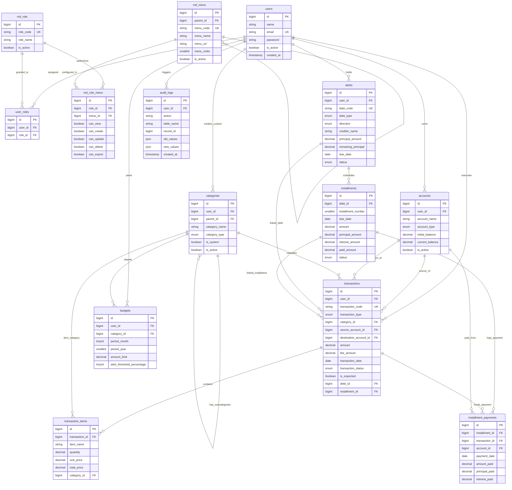

# DOKUMEN PERANCANGAN DATABASE MYFINANCE
**Personal Finance Management System**
*Versi: 1.0.0 | Status: Dokumen Desain & Spesifikasi Arsitektur*

---

## 1. OVERVIEW SISTEM

**MyFinance** adalah aplikasi *Personal Finance Management System* berbasis Laravel dan MySQL/MariaDB yang dirancang untuk membantu pengguna mengelola, memantau, dan menganalisis kesehatan keuangan pribadi mereka secara komprehensif, aman, dan terukur.

Aplikasi mendukung lingkungan multi-user di mana setiap pengguna memiliki data finansial pribadi yang terisolasi secara ketat (*row-level multi-tenancy*), didukung oleh kontrol otorisasi bertingkat berbasis peran (*Role-Based Access Control* / RBAC).

### Ruang Lingkup Fungsional
1. **User & Access Control**: Pengelolaan hak akses berjenjang (Super Admin, Admin, User) dengan otorisasi menu dan izin granular (*view, create, update, delete, export*).
2. **Account Management**: Manajemen berbagai jenis rekening dan dompet (*bank, e-wallet, cash, credit card, investment*).
3. **Transaction Management**: Pencatatan aktivitas finansial multidimensi (pemasukan, pengeluaran berjenjang hingga item belanjaan, transfer antar-rekening, dan pembayaran utang).
4. **Category Management**: Pengelompokan transaksi berbasis hierarki (kategori induk dan subkategori), mendukung kategori sistem bawaan (*system default*) serta kategori kustom pengguna.
5. **Debt & Installment Management**: Pengelolaan kewajiban utang/pinjaman dan piutang, pelacakan amortisasi cicilan, tenor, bunga, dan rekonsiliasi sisa pokok utang.
6. **Budget Management**: Perencanaan pagu anggaran pengeluaran bulanan per kategori dan monitoring realisasi penggunaan dana secara real-time.
7. **Financial Logic & Analytics**: Pemisahan yang ketat antara arus kas aktual (*actual cashflow*), arus kas proyeksi (*projected cashflow*), liabilitas berjalan (*outstanding debt*), dan saldo riil rekening.
8. **Audit Trail**: Pencatatan riwayat perubahan data krusial untuk akuntabilitas integritas sistem.

---

## 2. ARSITEKTUR DATABASE

Arsitektur database MyFinance dirancang dengan prinsip normalisasi data (Third Normal Form / 3NF) guna menjamin integritas referensial dan mencegah anomali data, sekaligus mempertahankan performa kueri yang optimal melalui strategi pengindeksan terarah.

```
+-----------------------------------------------------------------------------------+
|                              MYFINANCE DATABASE                                   |
+-----------------------------------------------------------------------------------+
|                                                                                   |
|  [ MODUL 1: USER & RBAC ]                                                        |
|  + users             + md_role             + md_menu                              |
|  + user_roles        + md_role_menu                                               |
|                                                                                   |
|  [ MODUL 2: MASTER KEUANGAN ]                                                     |
|  + accounts (Rekening/Dompet)              + categories (Kategori & Subkategori)  |
|                                                                                   |
|  [ MODUL 3: TRANSAKSI & DETAIL ]                                                  |
|  + transactions (Induk Transaksi Finansial)                                       |
|  + transaction_items (Rincian Item Pembelian/Belanjaan)                          |
|                                                                                   |
|  [ MODUL 4: UTANG & CICILAN ]                                                     |
|  + debts (Utang & Piutang)                 + installments (Jadwal Cicilan)        |
|  + installment_payments (Audit Pembayaran Cicilan)                                |
|                                                                                   |
|  [ MODUL 5: ANGGARAN & AUDIT ]                                                    |
|  + budgets (Pagu Anggaran Bulanan)         + audit_logs (Jejak Aktivitas)         |
|                                                                                   |
+-----------------------------------------------------------------------------------+
```

### Konvensi Desain
- **Penamaan Tabel**: Huruf kecil jamak (*plural*), snake_case (contoh: `users`, `accounts`, `transactions`, `installment_payments`). Tabel master referensi sistem diawali prefiks `md_` (contoh: `md_role`, `md_menu`, `md_role_menu`).
- **Penamaan Kolom**: snake_case, deskriptif, eksplisit (contoh: `user_id`, `source_account_id`, `amount`).
- **Primary Key**: Konstan menggunakan kolom `id` bertipe `BIGINT UNSIGNED AUTO_INCREMENT`.
- **Foreign Key**: Format `[singular_table_name]_id`, berelasi dengan tabel rujukan dengan penegakan integritas referensial (`ON DELETE RESTRICT` untuk data transaksi vital demi keamanan data finansial).
- **Tipe Data Moneter**: Wajib menggunakan `DECIMAL(16, 2)` guna menghindari *floating-point rounding error*. Nilai presisi mendukung transaksi hingga ratusan triliun rupiah dengan dua digit desimal sen.
- **Tipe Data Waktu**: Penyimpanan tanggal operasional menggunakan `DATE` (format ISO `YYYY-MM-DD`), waktu transaksi menggunakan `TIME` atau `DATETIME`, dan metadata audit menggunakan `TIMESTAMP` (`created_at`, `updated_at`, `deleted_at`).
- **Soft Deletes**: Diterapkan pada entitas yang memiliki dependensi historis (akun, transaksi, utang, kategori) melalui kolom `deleted_at` (`nullable timestamp`).

---

## 3. DAFTAR SELURUH TABEL

| No | Nama Tabel | Modul | Keterangan Fungsi |
| :---: | :--- | :--- | :--- |
| 1 | `users` | User & RBAC | Menyimpan identitas akun pengguna dan autentikasi Laravel |
| 2 | `md_role` | User & RBAC | Master peran pengguna (*Super Admin, Admin, User*) |
| 3 | `md_menu` | User & RBAC | Master menu aplikasi hierarkis (parent-child navigation) |
| 4 | `md_role_menu` | User & RBAC | Matriks hak akses menu dan permission granular per peran |
| 5 | `user_roles` | User & RBAC | Tabel pivot pemetaan pengguna ke satu atau beberapa peran |
| 6 | `accounts` | Account Management | Rekening bank, e-wallet, uang tunai, dan dompet pengguna |
| 7 | `categories` | Category Management | Kategori pemasukan dan pengeluaran (sistem & kustom) |
| 8 | `transactions` | Transaction Management | Header transaksi pemasukan, pengeluaran, transfer, dan cicilan |
| 9 | `transaction_items` | Transaction Management | Detail baris barang/kebutuhan belanja per transaksi |
| 10 | `debts` | Debt Management | Data pinjaman dana/utang piutang dan kewajiban finansial |
| 11 | `installments` | Installment Management | Jadwal termin dan status pembayaran cicilan utang |
| 12 | `installment_payments` | Installment Management | Catatan riwayat pembayaran cicilan multi-termin |
| 13 | `budgets` | Budget Management | Pagu batas anggaran pengeluaran bulanan per kategori |
| 14 | `audit_logs` | Audit Trail | Log rekaman jejak audit perubahan data finansial penting |

---

## 4. STRUKTUR KOLOM DAN SPESIFIKASI TABEL

### 4.1. Modul User Management & RBAC

#### 1. Tabel `users`
Menyimpan data otentikasi dan profil pengguna.

| Kolom | Tipe Data | Nullable | Default | Keterangan |
| :--- | :--- | :---: | :---: | :--- |
| `id` | BIGINT UNSIGNED | Tidak | AUTO | Primary Key |
| `name` | VARCHAR(100) | Tidak | - | Nama lengkap pengguna |
| `email` | VARCHAR(150) | Tidak | - | Alamat email unik untuk login |
| `email_verified_at` | TIMESTAMP | Ya | NULL | Waktu verifikasi alamat email |
| `password` | VARCHAR(255) | Tidak | - | Hash password bcrypt / argon2id |
| `phone_number` | VARCHAR(25) | Ya | NULL | Nomor kontak pengguna |
| `avatar_url` | VARCHAR(255) | Ya | NULL | Path/URL foto profil |
| `is_active` | BOOLEAN | Tidak | 1 | Status keaktifan akun (1=aktif, 0=nonaktif) |
| `remember_token` | VARCHAR(100) | Ya | NULL | Token sesi "remember me" Laravel |
| `created_at` | TIMESTAMP | Ya | CURRENT | Waktu pendaftaran akun |
| `updated_at` | TIMESTAMP | Ya | CURRENT | Waktu modifikasi data terakhir |
| `deleted_at` | TIMESTAMP | Ya | NULL | Soft delete timestamp |

- **Primary Key**: `id`
- **Unique Constraint**: `email`
- **Index**: `(email)`, `(is_active)`

---

#### 2. Tabel `md_role`
Menyimpan master peran hak akses aplikasi.

| Kolom | Tipe Data | Nullable | Default | Keterangan |
| :--- | :--- | :---: | :---: | :--- |
| `id` | BIGINT UNSIGNED | Tidak | AUTO | Primary Key |
| `role_code` | VARCHAR(30) | Tidak | - | Kode unik role (`super_admin`, `admin`, `user`) |
| `role_name` | VARCHAR(50) | Tidak | - | Nama label peran (`Super Admin`, `Admin`, `User`) |
| `description` | VARCHAR(255) | Ya | NULL | Deskripsi wewenang peran |
| `is_active` | BOOLEAN | Tidak | 1 | Status keaktifan peran |
| `created_at` | TIMESTAMP | Ya | CURRENT | Waktu dibuat |
| `updated_at` | TIMESTAMP | Ya | CURRENT | Waktu diubah |

- **Primary Key**: `id`
- **Unique Constraint**: `role_code`
- **Index**: `(role_code)`, `(is_active)`

---

#### 3. Tabel `md_menu`
Menyimpan struktur menu navigasi berhirarki (mendukung parent-child hingga tak terbatas).

| Kolom | Tipe Data | Nullable | Default | Keterangan |
| :--- | :--- | :---: | :---: | :--- |
| `id` | BIGINT UNSIGNED | Tidak | AUTO | Primary Key |
| `parent_id` | BIGINT UNSIGNED | Ya | NULL | Relasi ke `md_menu.id` untuk sub-menu |
| `menu_code` | VARCHAR(50) | Tidak | - | Kode unik pengenal menu (contoh: `TRANSACTIONS`) |
| `menu_name` | VARCHAR(100) | Tidak | - | Label menu yang tampil pada UI sidebar |
| `menu_url` | VARCHAR(150) | Tidak | - | URL / Named route path (contoh: `/transactions`) |
| `menu_icon` | VARCHAR(50) | Ya | NULL | Nama ikon SVG / TailAdmin icon |
| `menu_order` | SMALLINT | Tidak | 0 | Urutan posisi menu pada antarmuka |
| `is_active` | BOOLEAN | Tidak | 1 | Penentu apakah menu aktif ditampilkan |
| `created_at` | TIMESTAMP | Ya | CURRENT | Waktu dibuat |
| `updated_at` | TIMESTAMP | Ya | CURRENT | Waktu diubah |

- **Primary Key**: `id`
- **Foreign Key**: `parent_id` references `md_menu(id)` ON DELETE CASCADE
- **Unique Constraint**: `menu_code`
- **Index**: `(parent_id)`, `(menu_order)`, `(is_active)`

---

#### 4. Tabel `md_role_menu`
Matriks hak akses dan permission granular per peran terhadap setiap menu.

| Kolom | Tipe Data | Nullable | Default | Keterangan |
| :--- | :--- | :---: | :---: | :--- |
| `id` | BIGINT UNSIGNED | Tidak | AUTO | Primary Key |
| `role_id` | BIGINT UNSIGNED | Tidak | - | Relasi ke `md_role.id` |
| `menu_id` | BIGINT UNSIGNED | Tidak | - | Relasi ke `md_menu.id` |
| `can_view` | BOOLEAN | Tidak | 0 | Izin melihat menu dan membaca data (Read) |
| `can_create` | BOOLEAN | Tidak | 0 | Izin menambah data baru (Create) |
| `can_update` | BOOLEAN | Tidak | 0 | Izin mengubah/memperbarui data (Update) |
| `can_delete` | BOOLEAN | Tidak | 0 | Izin menghapus data (Delete) |
| `can_export` | BOOLEAN | Tidak | 0 | Izin mengekspor data (Export PDF/Excel) |
| `created_at` | TIMESTAMP | Ya | CURRENT | Waktu dibuat |
| `updated_at` | TIMESTAMP | Ya | CURRENT | Waktu diubah |

- **Primary Key**: `id`
- **Foreign Key**:
  - `role_id` references `md_role(id)` ON DELETE CASCADE
  - `menu_id` references `md_menu(id)` ON DELETE CASCADE
- **Unique Constraint**: `(role_id, menu_id)`
- **Index**: `(role_id)`, `(menu_id)`

---

#### 5. Tabel `user_roles`
Tabel pemetaan relasi *many-to-many* antara pengguna dan perannya.

| Kolom | Tipe Data | Nullable | Default | Keterangan |
| :--- | :--- | :---: | :---: | :--- |
| `id` | BIGINT UNSIGNED | Tidak | AUTO | Primary Key |
| `user_id` | BIGINT UNSIGNED | Tidak | - | Relasi ke `users.id` |
| `role_id` | BIGINT UNSIGNED | Tidak | - | Relasi ke `md_role.id` |
| `created_at` | TIMESTAMP | Ya | CURRENT | Waktu penugasan role |
| `updated_at` | TIMESTAMP | Ya | CURRENT | Waktu pembaruan |

- **Primary Key**: `id`
- **Foreign Key**:
  - `user_id` references `users(id)` ON DELETE CASCADE
  - `role_id` references `md_role(id)` ON DELETE CASCADE
- **Unique Constraint**: `(user_id, role_id)`
- **Index**: `(user_id)`, `(role_id)`

---

### 4.2. Modul Account Management

#### 6. Tabel `accounts`
Menyimpan rekening bank, dompet digital, akun kartu kredit, dan kas tunai milik pengguna.

| Kolom | Tipe Data | Nullable | Default | Keterangan |
| :--- | :--- | :---: | :---: | :--- |
| `id` | BIGINT UNSIGNED | Tidak | AUTO | Primary Key |
| `user_id` | BIGINT UNSIGNED | Tidak | - | Kepemilikan akun (`users.id`) |
| `account_name` | VARCHAR(100) | Tidak | - | Nama rekening (contoh: "BCA Tabungan Utama") |
| `account_number` | VARCHAR(50) | Ya | NULL | Nomor rekening/kartu jika relevan |
| `account_type` | ENUM | Tidak | - | `bank`, `e_wallet`, `cash`, `credit_card`, `investment`, `other` |
| `currency_code` | VARCHAR(3) | Tidak | 'IDR' | Kode ISO mata uang (IDR, USD, dll) |
| `initial_balance` | DECIMAL(16,2) | Tidak | 0.00 | Saldo awal saat rekening pertama kali didaftarkan |
| `current_balance` | DECIMAL(16,2) | Tidak | 0.00 | Saldo berjalan terkini yang telah terekonsiliasi |
| `color` | VARCHAR(20) | Ya | '#10B981' | Kode warna hex untuk visualisasi kartu rekening |
| `icon` | VARCHAR(50) | Ya | NULL | Identifier ikon rekening |
| `is_active` | BOOLEAN | Tidak | 1 | Status aktif (1=aktif, 0=diarsipkan/ditutup) |
| `notes` | TEXT | Ya | NULL | Catatan tambahan |
| `created_at` | TIMESTAMP | Ya | CURRENT | Waktu pembuatan data |
| `updated_at` | TIMESTAMP | Ya | CURRENT | Waktu pembaruan data |
| `deleted_at` | TIMESTAMP | Ya | NULL | Soft delete timestamp |

- **Primary Key**: `id`
- **Foreign Key**: `user_id` references `users(id)` ON DELETE RESTRICT
- **Index**: `(user_id)`, `(user_id, is_active)`, `(account_type)`

---

### 4.3. Modul Category Management

#### 7. Tabel `categories`
Menyimpan kategori pemasukan dan pengeluaran, baik kategori bawaan sistem (*system-wide*) maupun kategori kustom milik pengguna.

| Kolom | Tipe Data | Nullable | Default | Keterangan |
| :--- | :--- | :---: | :---: | :--- |
| `id` | BIGINT UNSIGNED | Tidak | AUTO | Primary Key |
| `user_id` | BIGINT UNSIGNED | Ya | NULL | Kepemilikan kustom (`users.id`). NULL = Kategori Sistem Bawaan |
| `parent_id` | BIGINT UNSIGNED | Ya | NULL | Relasi ke `categories.id` untuk subkategori |
| `category_name` | VARCHAR(100) | Tidak | - | Nama kategori (contoh: "Makanan & Minuman") |
| `category_type` | ENUM | Tidak | - | `income`, `expense` |
| `color` | VARCHAR(20) | Ya | '#10B981' | Warna tema kategori |
| `icon` | VARCHAR(50) | Ya | NULL | Identifier ikon kategori |
| `is_system` | BOOLEAN | Tidak | 0 | 1 jika kategori default sistem yang tidak bisa dihapus |
| `is_active` | BOOLEAN | Tidak | 1 | Status keaktifan kategori |
| `created_at` | TIMESTAMP | Ya | CURRENT | Waktu dibuat |
| `updated_at` | TIMESTAMP | Ya | CURRENT | Waktu diubah |
| `deleted_at` | TIMESTAMP | Ya | NULL | Soft delete timestamp |

- **Primary Key**: `id`
- **Foreign Key**:
  - `user_id` references `users(id)` ON DELETE CASCADE
  - `parent_id` references `categories(id)` ON DELETE SET NULL
- **Index**: `(user_id)`, `(user_id, category_type, is_active)`, `(is_system)`

---

### 4.4. Modul Transaction Management

#### 8. Tabel `transactions`
Menyimpan seluruh catatan transaksi keuangan utama (pemasukan, pengeluaran, transfer, pembayaran utang).

| Kolom | Tipe Data | Nullable | Default | Keterangan |
| :--- | :--- | :---: | :---: | :--- |
| `id` | BIGINT UNSIGNED | Tidak | AUTO | Primary Key |
| `user_id` | BIGINT UNSIGNED | Tidak | - | Kepemilikan transaksi (`users.id`) |
| `transaction_code` | VARCHAR(40) | Tidak | - | Kode referensi unik (contoh: `TX-20261112-0001`) |
| `transaction_type` | ENUM | Tidak | - | `income`, `expense`, `transfer`, `debt_payment` |
| `category_id` | BIGINT UNSIGNED | Ya | NULL | Kategori transaksi (NULL untuk transfer antar rekening) |
| `source_account_id` | BIGINT UNSIGNED | Ya | NULL | Rekening sumber (pengeluaran, transfer keluar, bayar utang) |
| `destination_account_id` | BIGINT UNSIGNED | Ya | NULL | Rekening tujuan (pemasukan, transfer masuk) |
| `amount` | DECIMAL(16,2) | Tidak | 0.00 | Nilai nominal transaksi pokok |
| `fee_amount` | DECIMAL(16,2) | Tidak | 0.00 | Biaya admin/transfer jika ada |
| `transaction_date` | DATE | Tidak | - | Tanggal terjadinya transaksi |
| `transaction_time` | TIME | Ya | NULL | Waktu transaksi |
| `transaction_status` | ENUM | Tidak | 'completed' | `completed` (terrealisasi), `pending` (menunggu), `cancelled` |
| `is_expected` | BOOLEAN | Tidak | 0 | 1 jika merupakan proyeksi/piutang terjadwal yang belum cair |
| `debt_id` | BIGINT UNSIGNED | Ya | NULL | Relasi ke `debts.id` jika transaksi terkait utang |
| `installment_id` | BIGINT UNSIGNED | Ya | NULL | Relasi ke `installments.id` jika membayar termin cicilan |
| `description` | VARCHAR(255) | Tidak | - | Ringkasan keterangan transaksi |
| `notes` | TEXT | Ya | NULL | Catatan narasi detail tambahan |
| `attachment_url` | VARCHAR(255) | Ya | NULL | Path/URL bukti struk atau invoice |
| `created_at` | TIMESTAMP | Ya | CURRENT | Waktu pencatatan sistem |
| `updated_at` | TIMESTAMP | Ya | CURRENT | Waktu pembaruan data |
| `deleted_at` | TIMESTAMP | Ya | NULL | Soft delete timestamp |

- **Primary Key**: `id`
- **Unique Constraint**: `transaction_code`
- **Foreign Key**:
  - `user_id` references `users(id)` ON DELETE RESTRICT
  - `category_id` references `categories(id)` ON DELETE RESTRICT
  - `source_account_id` references `accounts(id)` ON DELETE RESTRICT
  - `destination_account_id` references `accounts(id)` ON DELETE RESTRICT
  - `debt_id` references `debts(id)` ON DELETE SET NULL
  - `installment_id` references `installments(id)` ON DELETE SET NULL
- **Index**:
  - `(user_id, transaction_date)`
  - `(user_id, transaction_type)`
  - `(user_id, transaction_status)`
  - `(source_account_id)`
  - `(destination_account_id)`
  - `(category_id)`

---

#### 9. Tabel `transaction_items`
Menyimpan rincian item/barang yang dibeli dalam satu transaksi pengeluaran (misal: rincian struk belanja bulanan).

| Kolom | Tipe Data | Nullable | Default | Keterangan |
| :--- | :--- | :---: | :---: | :--- |
| `id` | BIGINT UNSIGNED | Tidak | AUTO | Primary Key |
| `transaction_id` | BIGINT UNSIGNED | Tidak | - | Relasi ke induk `transactions.id` |
| `item_name` | VARCHAR(150) | Tidak | - | Nama barang/kebutuhan yang dibeli |
| `quantity` | DECIMAL(10,2) | Tidak | 1.00 | Jumlah kuantitas barang |
| `unit_name` | VARCHAR(20) | Ya | 'pcs' | Satuan (pcs, kg, liter, porsi, paket) |
| `unit_price` | DECIMAL(16,2) | Tidak | 0.00 | Harga satuan barang |
| `total_price` | DECIMAL(16,2) | Tidak | 0.00 | Total harga (`quantity * unit_price`) |
| `category_id` | BIGINT UNSIGNED | Ya | NULL | Sub-kategori spesifik per barang jika diperlukan |
| `notes` | VARCHAR(255) | Ya | NULL | Keterangan tambahan per item |
| `created_at` | TIMESTAMP | Ya | CURRENT | Waktu dibuat |
| `updated_at` | TIMESTAMP | Ya | CURRENT | Waktu diubah |

- **Primary Key**: `id`
- **Foreign Key**:
  - `transaction_id` references `transactions(id)` ON DELETE CASCADE
  - `category_id` references `categories(id)` ON DELETE SET NULL
- **Index**: `(transaction_id)`, `(category_id)`

---

### 4.5. Modul Debt & Installment Management

#### 10. Tabel `debts`
Menyimpan pencatatan pinjaman dana/utang piutang pengguna.

| Kolom | Tipe Data | Nullable | Default | Keterangan |
| :--- | :--- | :---: | :---: | :--- |
| `id` | BIGINT UNSIGNED | Tidak | AUTO | Primary Key |
| `user_id` | BIGINT UNSIGNED | Tidak | - | Pemilik data utang (`users.id`) |
| `debt_code` | VARCHAR(40) | Tidak | - | Kode unik pinjaman (contoh: `DEBT-2026-001`) |
| `debt_type` | ENUM | Tidak | - | `platform_online`, `bank_loan`, `personal`, `credit_card`, `other` |
| `direction` | ENUM | Tidak | 'payable' | `payable` (utang kita), `receivable` (piutang kita ke pihak lain) |
| `creditor_name` | VARCHAR(150) | Tidak | - | Nama pemberi pinjaman/kreditur/platform |
| `principal_amount` | DECIMAL(16,2) | Tidak | 0.00 | Pokok pinjaman awal |
| `interest_rate` | DECIMAL(5,2) | Tidak | 0.00 | Persentase suku bunga (%) |
| `fee_amount` | DECIMAL(16,2) | Tidak | 0.00 | Biaya provisi/layanan platform awal |
| `total_amount` | DECIMAL(16,2) | Tidak | 0.00 | Total kewajiban (`pokok + total bunga + fee`) |
| `remaining_principal` | DECIMAL(16,2) | Tidak | 0.00 | Sisa pokok utang berjalan yang belum lunas |
| `start_date` | DATE | Tidak | - | Tanggal dana pinjaman diterima/mulai berlaku |
| `due_date` | DATE | Tidak | - | Tanggal batas akhir jatuh tempo pelunasan |
| `tenor_months` | INT UNSIGNED | Tidak | 1 | Jangka waktu pinjaman dalam satuan bulan |
| `status` | ENUM | Tidak | 'active' | `active`, `paid_off` (lunas), `defaulted` (macet), `cancelled` |
| `notes` | TEXT | Ya | NULL | Catatan syarat atau perjanjian pinjaman |
| `created_at` | TIMESTAMP | Ya | CURRENT | Waktu dibuat |
| `updated_at` | TIMESTAMP | Ya | CURRENT | Waktu diubah |
| `deleted_at` | TIMESTAMP | Ya | NULL | Soft delete timestamp |

- **Primary Key**: `id`
- **Unique Constraint**: `debt_code`
- **Foreign Key**: `user_id` references `users(id)` ON DELETE RESTRICT
- **Index**: `(user_id, status)`, `(user_id, due_date)`, `(direction)`

---

#### 11. Tabel `installments`
Menyimpan jadwal rincian termin cicilan bulanan yang terikat pada suatu utang.

| Kolom | Tipe Data | Nullable | Default | Keterangan |
| :--- | :--- | :---: | :---: | :--- |
| `id` | BIGINT UNSIGNED | Tidak | AUTO | Primary Key |
| `debt_id` | BIGINT UNSIGNED | Tidak | - | Relasi ke `debts.id` |
| `installment_number` | SMALLINT UNSIGNED | Tidak | 1 | Nomor urutan cicilan (contoh: 1, 2, 3... ke-12) |
| `due_date` | DATE | Tidak | - | Tanggal jatuh tempo cicilan termin ini |
| `amount` | DECIMAL(16,2) | Tidak | 0.00 | Total tagihan termin (`principal + interest + fee`) |
| `principal_amount` | DECIMAL(16,2) | Tidak | 0.00 | Bagian alokasi pokok utang |
| `interest_amount` | DECIMAL(16,2) | Tidak | 0.00 | Bagian alokasi bunga pinjaman |
| `fee_amount` | DECIMAL(16,2) | Tidak | 0.00 | Bagian alokasi denda/biaya admin termin |
| `paid_amount` | DECIMAL(16,2) | Tidak | 0.00 | Total akumulasi nominal yang sudah dibayarkan |
| `status` | ENUM | Tidak | 'unpaid' | `unpaid`, `partially_paid`, `paid`, `overdue` |
| `payment_date` | DATE | Ya | NULL | Tanggal realisasi pembayaran lunas termin ini |
| `notes` | VARCHAR(255) | Ya | NULL | Catatan termin cicilan |
| `created_at` | TIMESTAMP | Ya | CURRENT | Waktu dibuat |
| `updated_at` | TIMESTAMP | Ya | CURRENT | Waktu diubah |

- **Primary Key**: `id`
- **Foreign Key**: `debt_id` references `debts(id)` ON DELETE CASCADE
- **Unique Constraint**: `(debt_id, installment_number)`
- **Index**: `(debt_id, status)`, `(due_date)`, `(status)`

---

#### 12. Tabel `installment_payments`
Menyimpan audit riwayat pembayaran cicilan untuk mendukung pembayaran sebagian (*partial payments*) dan integrasi transaksi finansial.

| Kolom | Tipe Data | Nullable | Default | Keterangan |
| :--- | :--- | :---: | :---: | :--- |
| `id` | BIGINT UNSIGNED | Tidak | AUTO | Primary Key |
| `installment_id` | BIGINT UNSIGNED | Tidak | - | Relasi ke `installments.id` |
| `transaction_id` | BIGINT UNSIGNED | Tidak | - | Relasi ke `transactions.id` sebagai bukti transaksi keluar |
| `account_id` | BIGINT UNSIGNED | Tidak | - | Rekening yang digunakan untuk membayar |
| `payment_date` | DATE | Tidak | - | Tanggal uang ditransfer/dibayarkan |
| `amount_paid` | DECIMAL(16,2) | Tidak | 0.00 | Total nominal yang dibayarkan |
| `principal_paid` | DECIMAL(16,2) | Tidak | 0.00 | Alokasi pengurangan pokok utang |
| `interest_paid` | DECIMAL(16,2) | Tidak | 0.00 | Alokasi pembayaran bunga |
| `notes` | VARCHAR(255) | Ya | NULL | Catatan referensi transfer pembayaran |
| `created_at` | TIMESTAMP | Ya | CURRENT | Waktu pencatatan |
| `updated_at` | TIMESTAMP | Ya | CURRENT | Waktu pembaruan |

- **Primary Key**: `id`
- **Foreign Key**:
  - `installment_id` references `installments(id)` ON DELETE CASCADE
  - `transaction_id` references `transactions(id)` ON DELETE RESTRICT
  - `account_id` references `accounts(id)` ON DELETE RESTRICT
- **Index**: `(installment_id)`, `(transaction_id)`, `(account_id)`, `(payment_date)`

---

### 4.6. Modul Budget Management

#### 13. Tabel `budgets`
Menyimpan penetapan pagu anggaran bulanan per kategori untuk mengontrol batas belanja pengguna.

| Kolom | Tipe Data | Nullable | Default | Keterangan |
| :--- | :--- | :---: | :---: | :--- |
| `id` | BIGINT UNSIGNED | Tidak | AUTO | Primary Key |
| `user_id` | BIGINT UNSIGNED | Tidak | - | Pemilik anggaran (`users.id`) |
| `category_id` | BIGINT UNSIGNED | Tidak | - | Kategori yang dianggarkan (`categories.id`) |
| `period_month` | TINYINT UNSIGNED | Tidak | - | Angka bulan (1 = Januari s/d 12 = Desember) |
| `period_year` | SMALLINT UNSIGNED | Tidak | - | Tahun anggaran (contoh: 2026) |
| `amount_limit` | DECIMAL(16,2) | Tidak | 0.00 | Batas maksimal nominal anggaran |
| `alert_threshold_percentage` | TINYINT UNSIGNED | Tidak | 80 | Persentase peringatan saat mendekati batas (misal: 80%) |
| `notes` | VARCHAR(255) | Ya | NULL | Catatan target penghematan anggaran |
| `created_at` | TIMESTAMP | Ya | CURRENT | Waktu dibuat |
| `updated_at` | TIMESTAMP | Ya | CURRENT | Waktu diubah |

- **Primary Key**: `id`
- **Foreign Key**:
  - `user_id` references `users(id)` ON DELETE CASCADE
  - `category_id` references `categories(id)` ON DELETE RESTRICT
- **Unique Constraint**: `(user_id, category_id, period_month, period_year)`
- **Index**: `(user_id, period_year, period_month)`, `(category_id)`

---

### 4.7. Modul Audit Trail

#### 14. Tabel `audit_logs`
Mencatat riwayat aktivitas manipulasi data vital keuangan untuk keperluan keamanan dan pembuktian rekam jejak.

| Kolom | Tipe Data | Nullable | Default | Keterangan |
| :--- | :--- | :---: | :---: | :--- |
| `id` | BIGINT UNSIGNED | Tidak | AUTO | Primary Key |
| `user_id` | BIGINT UNSIGNED | Ya | NULL | Pelaku aksi (`users.id`). NULL jika aksi sistem |
| `action` | VARCHAR(20) | Tidak | - | `CREATE`, `UPDATE`, `DELETE`, `RECONCILE`, `LOGIN` |
| `table_name` | VARCHAR(50) | Tidak | - | Nama tabel target entitas |
| `record_id` | BIGINT UNSIGNED | Tidak | - | ID record yang terdampak |
| `old_values` | JSON | Ya | NULL | Snapshot data sebelum diubah (JSON format) |
| `new_values` | JSON | Ya | NULL | Snapshot data setelah diubah (JSON format) |
| `ip_address` | VARCHAR(45) | Ya | NULL | Alamat IPv4/IPv6 pelaku |
| `user_agent` | TEXT | Ya | NULL | Informasi browser/klien |
| `created_at` | TIMESTAMP | Ya | CURRENT | Waktu kejadian |

- **Primary Key**: `id`
- **Foreign Key**: `user_id` references `users(id)` ON DELETE SET NULL
- **Index**: `(user_id)`, `(table_name, record_id)`, `(action)`, `(created_at)`

---

## 5. RELASI ANTAR TABEL DAN ENTITY RELATIONSHIP DIAGRAM (ERD)

### 5.1. Ringkasan Relasi Utama
- **`users` 1 : N `user_roles` N : 1 `md_role`**: Relasi pengguna dengan banyak peran.
- **`md_role` 1 : N `md_role_menu` N : 1 `md_menu`**: Matriks hak akses peran terhadap menu.
- **`md_menu` 1 : N `md_menu`**: Relasi hierarki menu bertingkat (parent-child).
- **`users` 1 : N `accounts`**: Satu pengguna memiliki banyak rekening/dompet.
- **`users` 1 : N `categories`**: Satu pengguna dapat membuat banyak kategori kustom.
- **`categories` 1 : N `categories`**: Relasi hierarki kategori (parent-child).
- **`users` 1 : N `transactions`**: Seluruh transaksi dimiliki oleh seorang pengguna.
- **`accounts` 1 : N `transactions` (sebagai `source_account_id`)**: Rekening sumber dana.
- **`accounts` 1 : N `transactions` (sebagai `destination_account_id`)**: Rekening penerima dana.
- **`categories` 1 : N `transactions`**: Transaksi diklasifikasikan ke dalam kategori.
- **`transactions` 1 : N `transaction_items`**: Satu transaksi belanja dapat memiliki banyak item detail.
- **`users` 1 : N `debts`**: Pinjaman dana/utang piutang dimiliki oleh pengguna.
- **`debts` 1 : N `installments`**: Satu kewajiban utang memiliki banyak termin jadwal cicilan.
- **`installments` 1 : N `installment_payments` N : 1 `transactions`**: Pembayaran termin cicilan terhubung ke mutasi transaksi pengeluaran.
- **`users` 1 : N `budgets` N : 1 `categories`**: Batas anggaran per kategori per bulan milik pengguna.

### 5.2. Diagram ERD (Mermaid)



---

## 6. PENJELASAN USER MANAGEMENT DAN RBAC

### 6.1. Definisi Tiga Peran (*Roles*)
1. **Super Admin**:
   - Memiliki wewenang absolut atas konfigurasi sistem.
   - Mengelola master pengguna (*CRUD users*), mengubah status keaktifan akun, dan menetapkan peran.
   - Mengelola master peran (*md_role*), struktur navigasi (*md_menu*), dan konfigurasi matriks izin (*md_role_menu*).
   - Memantau log audit sistem (*audit_logs*).
2. **Admin**:
   - Membantu operasional administratif aplikasi berdasarkan izin eksplisit yang diberikan pada matriks `md_role_menu`.
   - **Prinsip Penting**: Admin tidak otomatis memiliki hak akses melihat atau memanipulasi data finansial pribadi milik pengguna lain tanpa otorisasi tertulis.
3. **User**:
   - Pengguna akhir sistem keuangan pribadi.
   - Memiliki kendali penuh atas data miliknya sendiri (*accounts, transactions, categories, debts, installments, budgets*).
   - Terisolasi 100% dari data pengguna lain (*Strict Row-Level Tenancy*).

### 6.2. Mekanisme Validasi Hak Akses Backend
Keamanan tidak boleh hanya mengandalkan penyembunyian tombol atau menu di sisi frontend (Blade). Backend wajib memvalidasi setiap *request* melalui:
1. **Middleware Otorisasi Menu**:
   Setiap HTTP Request ke endpoint tertentu dicek apakah role pengguna memiliki `can_view = 1` untuk rute menu bersangkutan.
2. **Laravel Form Request & Policy**:
   Setiap aksi manipulasi data diverifikasi terhadap flag izin:
   - Tombol "Tambah" memicu pengecekan `can_create == true`.
   - Tombol "Ubah" memicu pengecekan `can_update == true`.
   - Tombol "Hapus" memicu pengecekan `can_delete == true`.
   - Tombol "Export PDF/Excel" memicu pengecekan `can_export == true`.
   Jika permission bernilai `0`, server secara otomatis melempar HTTP `403 Forbidden`.

---

## 7. DATA OWNERSHIP DAN ISOLASI KEAMANAN

### 7.1. Prinsip Row-Level Multi-Tenancy
Setiap tabel yang menyimpan data finansial pengguna (`accounts`, `categories`, `transactions`, `debts`, `budgets`) secara wajib menyertakan kolom `user_id` yang berelasi ke `users.id`.

### 7.2. Pencegahan Insecure Direct Object References (IDOR)
Untuk mencegah eksploitasi manipulasi parameter ID pada URL atau form (misalnya mengubah `/transactions/15` milik pengguna lain), sistem menerapkan perlindungan berlapis:
1. **Laravel Global Scope (`BelongsToUser`)**:
   Setiap kueri Eloquent secara implisit menyaring data berdasarkan pengguna yang sedang terautentikasi:
   ```php
   // Otomatis menambahkan: WHERE user_id = auth()->id()
   static::addGlobalScope('user_filter', function ($builder) {
       if (auth()->check() && !auth()->user()->isSuperAdmin()) {
           $builder->where('user_id', auth()->id());
       }
   });
   ```
2. **Laravel Route Model Binding & Policy Enforcement**:
   Setiap controller mewajibkan eksekusi `$this->authorize('update', $transaction);` di mana Policy memeriksa:
   ```php
   public function update(User $user, Transaction $transaction): bool
   {
       return $transaction->user_id === $user->id;
   }
   ```
3. **Database Foreign Key Integrity**:
   Menghindari transaksi mengaitkan `source_account_id` atau `category_id` milik pengguna lain dengan validasi database dan FormRequest validation rule: `Rule::exists('accounts', 'id')->where('user_id', auth()->id())`.

---

## 8. FINANCIAL BUSINESS RULES & LOGIC ENGINE

Bagian ini mendefinisikan aturan matematika dan akuntansi personal yang mengatur sistem MyFinance.

### 8.1. Taksonomi Jenis Transaksi dan Pengaruhnya
Sistem memisahkan secara ketat entitas finansial menjadi 4 kuadran:

| Jenis Transaksi | Status & Kondisi | Pengaruh ke Saldo Rekening | Pengaruh ke Actual Cashflow | Pengaruh ke Projected Cashflow | Pengaruh ke Outstanding Debt |
| :--- | :--- | :--- | :--- | :--- | :--- |
| **Actual Income** | `completed`, `is_expected = 0` | **+ (Menambah)** saldo `destination_account_id` | **+ Inflow** | Terhitung | Tidak Berpengaruh |
| **Expected Income** | `pending` / `is_expected = 1` | **Netral (0)** (tidak menambah saldo riil) | **Netral (0)** | **+ Inflow** | Tidak Berpengaruh |
| **Actual Expense** | `completed` | **- (Mengurangi)** saldo `source_account_id` | **- Outflow** | Terhitung | Tidak Berpengaruh |
| **Transfer** | `completed` | **-** `source_account_id`<br>**+** `destination_account_id` | **Netral (0)** *(kecuali fee_amount)* | Netral (0) | Tidak Berpengaruh |
| **Debt Payment** | `completed` | **- (Mengurangi)** saldo `source_account_id` | **- Financing Outflow** | Terhitung | **- (Mengurangi)** sisa pokok utang |

---

### 8.2. Penjelasan 10 Aturan Finansial Utama

#### Aturan 1: Income yang Diterima Menambah Saldo
Transaksi pemasukan dengan status `completed` dan `is_expected = 0` secara instan menambah kolom `current_balance` pada rekening tujuan (`destination_account_id`).

#### Aturan 2: Expected Income Tidak Menambah Saldo Aktual
Pemasukan yang masih berupa estimasi, piutang, gaji belum cair, atau invoice pending disimpan dengan penanda `is_expected = 1` atau status `pending`. Dana ini **tidak boleh** masuk ke dalam saldo riil rekening sebelum diubah statusnya menjadi `completed` melalui aksi rekonsiliasi penerimaan dana.

#### Aturan 3: Expense Mengurangi Saldo Rekening
Setiap pengeluaran belanja, tagihan, atau konsumsi mengurangi `current_balance` pada `source_account_id`. Jika saldo tidak mencukupi, sistem dapat memberikan peringatan saldo negatif (atau overdraw protection sesuai preferensi akun).

#### Aturan 4: Transfer Antar Rekening Bersifat Netral Terhadap Arus Kas
Perpindahan dana dari Akun A ke Akun B mengurangi saldo Akun A sebesar `amount + fee_amount` dan menambah saldo Akun B sebesar `amount`. Transaksi ini **bukan pemasukan** dan **bukan pengeluaran belanja**, sehingga total kekayaan bersih (*Net Worth*) tetap stabil. Jika terdapat `fee_amount` (biaya admin transfer), hanya nominal `fee_amount` yang dicatat ke dalam pengeluaran biaya administrasi.

#### Aturan 5: Pembayaran Utang Mengurangi Saldo dan Mengurangi Liabilitas
Saat pengguna membayar cicilan pinjaman:
- Saldo kas/rekening berkurang sebesar total nominal pembayaran.
- Sisa pokok utang (`debts.remaining_principal`) berkurang sebesar porsi pokok yang dibayarkan (`principal_paid`).
- Status termin cicilan (`installments.status`) diperbarui menjadi `paid`.

#### Aturan 6: Pencegahan Double-Counting Pembayaran Utang
Sistem memisahkan secara tegas:
- **Pengeluaran Konsumsi / Operasional**: Biaya makan, belanja, listrik, dll.
- **Pembayaran Liabilitas (Financing Outflow)**: Pembayaran pokok pinjaman.
Pembayaran utang **tidak boleh dihitung dua kali** sebagai biaya konsumsi bulanan. Jika utang awalnya digunakan untuk konsumsi (misal paylater belanja barang Rp1.000.000), maka belanja barang tersebut dicatat sebagai transaksi expense saat transaksi terjadi, sedangkan cicilan bulanannya diakui sebagai penyelesaian liabilitas.

#### Aturan 7: Outstanding Debt Terpisah dari Cashflow
Total kewajiban utang (*Outstanding Debt*) dihitung terpisah dari laporan arus kas. Outstanding Debt adalah metrik posisi neraca:
$$\text{Outstanding Debt} = \sum (\text{remaining\_principal dari seluruh utang yang berstatus active})$$

#### Aturan 8: Rekonsiliasi Saldo Akun dengan Histori Transaksi
Saldo akun `accounts.current_balance` harus selalu dapat direkonsiliasi dan dibuktikan secara matematis melalui histori mutasi:
$$\text{Reconciled Balance} = \text{initial\_balance} + \sum (\text{Income}) - \sum (\text{Expense}) + \sum (\text{Transfer In}) - \sum (\text{Transfer Out}) - \sum (\text{Debt Payments})$$

#### Aturan 9: Arus Kas Aktual vs Arus Kas Proyeksi
- **Actual Cashflow**:
  $$\text{Actual Net Cashflow} = \text{Total Realized Income} - \text{Total Realized Expenses} - \text{Total Debt Payments Paid}$$
- **Projected Cashflow**:
  $$\text{Projected Cashflow} = (\text{Actual Income} + \text{Expected Income}) - (\text{Actual Expense} + \text{Budgeted/Scheduled Expenses}) - \text{Upcoming Installments}$$

#### Aturan 10: Posisi Arus Kas Bernilai Fleksibel (Surplus atau Defisit)
Posisi kas bulanan bernilai positif (*surplus/saving*) jika pemasukan lebih besar dari seluruh pengeluaran dan kewajiban, atau bernilai negatif (*defisit*) jika pengeluaran melebihi pemasukan.

---

## 9. ALUR OPERASIONAL TRANSAKSI & PEMBAYARAN UTANG

### 9.1. Alur Pencatatan Transaksi (Income, Expense, Transfer)

```
[ PENGGUNA ]
     |
     v
Pilih Jenis Transaksi
     |
     +---> [ INCOME ] --------> Tentukan Rekening Tujuan, Kategori, Nominal
     |                            |
     |                            v
     |                          Apakah dana sudah diterima?
     |                          /                         \
     |                    [YA] /                           \ [TIDAK]
     |                        v                             v
     |            Status: 'completed'             Status: 'pending', is_expected: 1
     |            Saldo Rekening Bertambah        Saldo Rekening TIDAK Berubah
     |            Masuk Actual Cashflow           Masuk Projected Cashflow
     |
     +---> [ EXPENSE ] -------> Tentukan Rekening Sumber, Kategori, Nominal
     |                            |
     |                            +--> (Opsional) Input Detail Barang (transaction_items)
     |                            |
     |                            v
     |                          Status: 'completed'
     |                          Saldo Rekening Berkurang
     |                          Masuk Actual Cashflow Negatif
     |                          Validasi ke Pagu Anggaran (budgets)
     |
     +---> [ TRANSFER ] ------> Tentukan Rekening Asal, Rekening Tujuan, Nominal, Fee
                                  |
                                  v
                                Status: 'completed'
                                Saldo Rekening Asal: -(Nominal + Fee)
                                Saldo Rekening Tujuan: +Nominal
                                Net Cashflow Operasional: 0 (Netral)
```

### 9.2. Alur Pembayaran Utang dan Pelunasan Cicilan

```
[ PENGGUNA ]
     |
     v
Pilih Utang / Jadwal Cicilan pada menu Debts & Installments
     |
     v
Sistem menampilkan Tagihan Termin Cicilan:
- Pokok (Principal): Rp900.000
- Bunga (Interest):   Rp100.000
- Total Pembayaran: Rp1.000.000
     |
     v
Pilih Rekening Pembayar (contoh: BCA) & Konfirmasi Bayar
     |
     v
Eksekusi Database Transaction (DB::transaction):
     |
     +---> 1. Insert ke tabel `transactions`:
     |        type: 'debt_payment', amount: Rp1.000.000, source: BCA
     |
     +---> 2. Kurangi Saldo `accounts` BCA sebesar Rp1.000.000
     |
     +---> 3. Insert ke tabel `installment_payments`:
     |        amount_paid: Rp1.000.000, principal_paid: Rp900.000, interest_paid: Rp100.000
     |
     +---> 4. Update tabel `installments`:
     |        paid_amount += Rp1.000.000, status = 'paid', payment_date = TODAY
     |
     +---> 5. Update tabel `debts`:
     |        remaining_principal -= Rp900.000
     |        Jika remaining_principal <= 0, ubah debts.status = 'paid_off'
     |
     v
Commit Transaksi Database (Selesai, Konsisten & Akurat)
```

---

## 10. CONTOH SKENARIO TRANSAKSI NYATA

### Skenario 1: Penerimaan Gaji Bulanan (Actual Income)
- **Kondisi Awal**: Rekening BCA memiliki saldo Rp5.000.000.
- **Aktivitas**: Pada tanggal 25 November 2026, pengguna menerima gaji bersih bulanan sebesar Rp12.000.000.
- **Pencatatan Database**:
  - `transactions`: `transaction_type = 'income'`, `destination_account_id = [ID BCA]`, `amount = 12000000.00`, `category_id = [Gaji]`, `transaction_status = 'completed'`, `is_expected = 0`.
- **Hasil**:
  - Saldo Rekening BCA menjadi: $\text{Rp}5.000.000 + \text{Rp}12.000.000 = \text{Rp}17.000.000$.
  - Actual Cashflow bulan November bertambah $+Rp12.000.000$.

---

### Skenario 2: Belanja Bulanan dengan Rincian Item (Itemized Expense)
- **Kondisi Awal**: Saldo Mandiri Rp8.000.000. Pagu Anggaran kategori "Supermarket" bulan November adalah Rp2.000.000.
- **Aktivitas**: Berbelanja di supermarket sebesar Rp750.000 dengan rincian:
  1. Beras 5 kg: 1 x Rp75.000 = Rp75.000
  2. Minyak Goreng 2L: 2 x Rp35.000 = Rp70.000
  3. Daging Sapi 1 kg: 1 x Rp140.000 = Rp140.000
  4. Susu & Kebutuhan Rumah Tangga: Rp465.000
- **Pencatatan Database**:
  - Header `transactions`: `transaction_type = 'expense'`, `source_account_id = [ID Mandiri]`, `amount = 750000.00`, `category_id = [Supermarket]`, `status = 'completed'`.
  - Detail `transaction_items`: 4 baris data item belanjaan yang terhubung ke `transaction_id`.
- **Hasil**:
  - Saldo Mandiri menjadi: $\text{Rp}8.000.000 - \text{Rp}750.000 = \text{Rp}7.250.000$.
  - Realisasi anggaran kategori Supermarket bertambah Rp750.000 (pemakaian 37.5% dari batas Rp2.000.000).

---

### Skenario 3: Top-Up Dompet Digital (Transfer Antar Rekening)
- **Kondisi Awal**: Saldo BCA Rp17.000.000, Saldo GoPay Rp50.000.
- **Aktivitas**: Top-up GoPay dari BCA sebesar Rp500.000 dengan biaya admin transfer Rp1.000.
- **Pencatatan Database**:
  - `transactions`: `transaction_type = 'transfer'`, `source_account_id = [ID BCA]`, `destination_account_id = [ID GoPay]`, `amount = 500000.00`, `fee_amount = 1000.00`, `status = 'completed'`.
- **Hasil**:
  - Saldo BCA berkurang sebesar $\text{Rp}500.000 + \text{Rp}1.000 = \text{Rp}501.000$ (Sisa: Rp16.499.000).
  - Saldo GoPay bertambah sebesar $\text{Rp}500.000$ (Total: Rp550.000).
  - Total kekayaan (*Net Worth*) hanya berkurang Rp1.000 (biaya admin). Tidak ada pencatatan pemasukan semu di GoPay.

---

### Skenario 4: Pembayaran Cicilan Pinjaman Bank / Gadget (Debt Payment)
- **Kondisi Awal**:
  - Rekening BCA: Rp16.499.000.
  - Data Utang `debts`: Pinjaman Gadget tenor 12 bulan, total pokok Rp12.000.000, sisa pokok saat ini Rp6.000.000.
  - Tagihan termin cicilan ke-7 `installments`: Pokok Rp1.000.000, Bunga Rp50.000 (Total tagihan: Rp1.050.000).
- **Aktivitas**: Pengguna membayar cicilan ke-7 menggunakan saldo BCA.
- **Pencatatan Database**:
  1. `transactions`: `transaction_type = 'debt_payment'`, `source_account_id = [ID BCA]`, `amount = 1050000.00`, `debt_id = [ID Utang Gadget]`, `installment_id = [ID Cicilan Ke-7]`.
  2. `installment_payments`: `amount_paid = 1050000.00`, `principal_paid = 1000000.00`, `interest_paid = 50000.00`.
  3. `installments`: `status = 'paid'`, `paid_amount = 1050000.00`, `payment_date = [Hari Ini]`.
  4. `debts`: `remaining_principal` berkurang dari $\text{Rp}6.000.000 - \text{Rp}1.000.000 = \text{Rp}5.000.000$.
- **Hasil**:
  - Saldo BCA menjadi: $\text{Rp}16.499.000 - \text{Rp}1.050.000 = \text{Rp}15.449.000$.
  - Outstanding Debt berkurang menjadi Rp5.000.000.
  - Pengeluaran konsumsi pribadi **tidak membengkak ganda** karena pokok utang diakui sebagai pengurangan kewajiban neraca.

---

## 11. REKOMENDASI IMPLEMENTASI LARAVEL

Saat tahap implementasi kode dimulai, disarankan menerapkan praktik terbaik Laravel berikut:

1. **Database Transactions (`DB::transaction`)**:
   Seluruh operasi finansial yang melibatkan lebih dari satu mutasi tabel (seperti transfer antar-rekening dan pembayaran cicilan) wajib dibungkus dalam `DB::transaction(function () { ... });` untuk menjamin sifat ACID (*Atomicity, Consistency, Isolation, Durability*).
2. **PHP 8.2+ Backed Enums**:
   Gunakan PHP Enum untuk status dan tipe demi *type-safety* kode:
   - `TransactionType: string { case Income = 'income'; case Expense = 'expense'; case Transfer = 'transfer'; case DebtPayment = 'debt_payment'; }`
   - `AccountType: string { case Bank = 'bank'; case EWallet = 'e_wallet'; case Cash = 'cash'; case CreditCard = 'credit_card'; }`
   - `DebtDirection: string { case Payable = 'payable'; case Receivable = 'receivable'; }`
3. **Eloquent Attribute Casting**:
   Lakukan casting pada model Eloquent:
   - `'amount' => 'decimal:2'`
   - `'transaction_date' => 'date'`
   - `'is_expected' => 'boolean'`
   - `'is_active' => 'boolean'`
4. **Model Observers / Service Pattern**:
   Gunakan `TransactionService` atau `TransactionObserver` untuk mengotomatisasi penyesuaian `accounts.current_balance` setiap kali transaksi dibuat, diubah, atau dihapus (*soft delete*).
5. **Laravel Policies & Form Requests**:
   Pemisahan aturan validasi form input pada `TransactionStoreRequest` dan otorisasi kepemilikan pada `TransactionPolicy`.

---

## 12. CATATAN ASUMSI DAN REKOMENDASI KONFIRMASI

Berikut beberapa asumsi desain yang dapat dikonfirmasi lebih lanjut oleh pemilik sistem saat pengembangan berlanjut:
1. **Multi-Currency (Mata Uang Asing)**:
   Saat ini skema menyediakan kolom `currency_code` pada tabel `accounts`. Pada tahap v1.0 diasumsikan seluruh transaksi dihitung dalam IDR (*Indonesian Rupiah*). Jika ke depan dibutuhkan konversi kurs otomatis (*exchange rate*), dapat ditambahkan tabel `md_exchange_rates`.
2. **Rekening Kredit / Kartu Kredit**:
   Pada akun bertipe `credit_card`, saldo dapat bernilai negatif yang merepresentasikan plafon kredit yang terpakai.
3. **Penyimpanan Struk / Lampiran Transaksi**:
   Disediakan kolom `attachment_url` pada `transactions`. Penyimpanan berkas disarankan memanfaatkan Laravel Storage Driver (Local Public Disk atau Amazon S3 / Cloudflare R2).

---
*Dokumen ini merupakan acuan resmi struktur basis data MyFinance v1.0. Jangan mengubah skema database tanpa memperbarui dokumen ini terlebih dahulu.*

